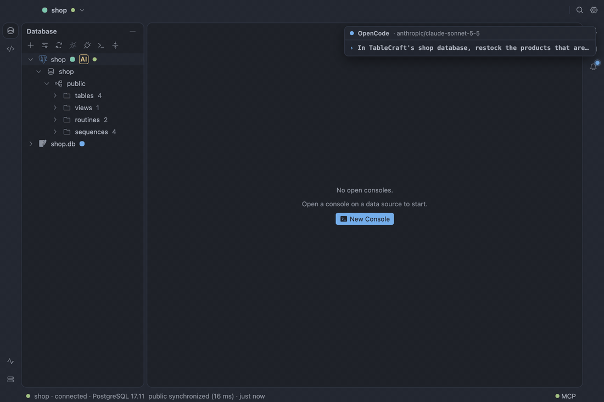
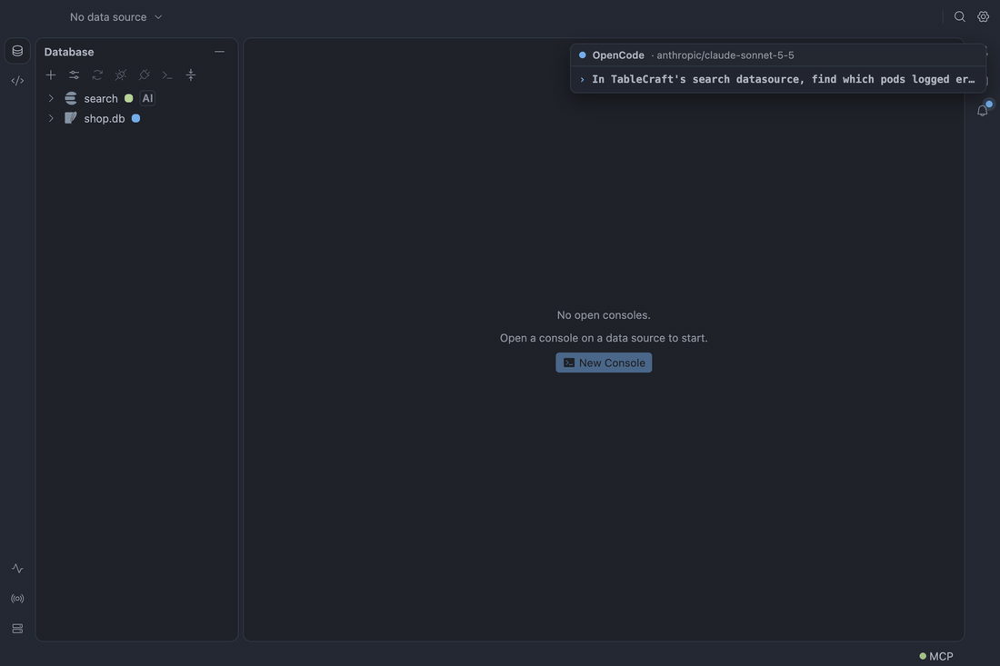

# Agents (MCP)

TableCraft can serve your data sources to AI agents such as Claude Code, OpenCode and Cursor over
the [Model Context Protocol](https://modelcontextprotocol.io). The server is off until you turn it
on, and each data source stays hidden from agents until you give it an access level.

## MCP server

The server listens on `http://127.0.0.1:47820/mcp`, on this machine only, and asks every client for
a bearer token. The app must be running for agents to reach it.

### Connect an agent

1. Open **Settings → MCP Server**, or click the robot button on the right edge of the window.
2. Turn on **Let AI agents reach TableCraft**.
3. Under **Connect a client**, pick your client and click **Copy with Token**.
4. Paste the configuration into your client's MCP settings.

The clipboard now holds the client's configuration with its token. The window never shows the token
itself.

## Access levels

Each data source starts **Off** for agents. Pick its level in the **Data source access** table of
**Settings → MCP Server**:

- **Off**: agents do not see the data source. Use it when the data source should stay out of
  agents' reach.
- **Ask before reads**: agents browse schemas, tables, columns and key names. Every query that
  returns rows, and every key value, waits for you to allow it, and writes are refused. Use it when
  the rows themselves are sensitive.
- **Read only**: agents list schemas and tables, describe a table, read its DDL, run `SELECT`s, and
  explain and format SQL. Their statements run in a read-only session, and anything else is
  refused. Use it when an agent only needs to read.
- **Ask before writes**: everything Read only allows, and the agent can also propose one change at
  a time, which runs only after you allow it. Use it when you want an agent to fix data while you
  check each statement.

Two rules cap the level. A data source marked read-only stays at Read only. One coloured red can be
raised past Read only only on its own page in the Data Sources dialog.

## Requests

When an agent asks for something its level does not allow on its own, the MCP chip in the status
bar turns amber with its dot pulsing. Nothing runs until you answer. A request left unanswered for a
minute is denied.

### Allow a statement

1. Click the amber MCP chip to open the request.
2. Read the statement and the agent's reason for it.
3. Click **Allow Once**.

The statement runs and its result goes back to the agent. Click **Deny** to refuse it instead. A
write request can go to **Open in Console**, where you run it yourself.

### Check the plan before you answer

While a statement waits, click **Plan** in the request. It shows how the database would run the
statement, without running it, and marks steps such as a full table scan or, on TiDB, estimates
made without statistics. The request keeps waiting until you answer.

### Read the statement as the agent sent it

The request lays the statement out with the formatter and your [Reformat Code](console.md)
settings, and highlights it. Turn **Format** off to read it as the agent sent it, which is always
what runs. The next request opens the same way.

## Results and limits

An answer carries at most `mcp.rowCap` rows, and the agent pages further with `fetch_rows`. When the
statement carries its [row limit in its SQL](data.md#result-grid), rows past the ones TableCraft
holds mean running it again up to the last row asked for. That page waits for you at every access
level, and **Allow re-runs** lasts the rest of the agent's session.

A statement running past `mcp.statementTimeoutSeconds` is stopped, by the database too where it
can, even if TableCraft cannot reach it. Passwords never leave TableCraft. Every agent statement is
kept in the query history, tagged with the client's name.

## Clients

The first call from a client you have not met turns the chip amber. Open it and choose **Allow** or
**Block**. A call left unanswered for a minute is refused. **Settings → MCP Server** lists the
clients you answered, where you can flip or forget each one.

## Notifications

While a request or a new client waits and TableCraft is in the background, a system notification
names the client, the data source and what it asks, and the dock icon counts what waits. Clicking
the notification brings the window forward with the request open, and you answer there. The
notification never shows the statement, the key or the agent's reason.

### Turn off notifications

Clear **Notify me when an agent waits for an answer** in **Settings → MCP Server**
(`mcp.notifications`). Your system's notification settings apply too.

## Per data source

Beside the access level in **Data source access**, three fields narrow what agents get from one
data source:

- **Schemas**: the schemas agents list and read. Blank keeps the schemas the Database pane shows.
- **Row cap**: overrides `mcp.rowCap`.
- **Timeout**: overrides `mcp.statementTimeoutSeconds`. The (i) before it says what really stops a
  statement there, from the server the data source last connected to. It is amber when some
  statements keep running past the limit, and ringed when TableCraft has not seen the server yet.

## Tools

Besides the catalog and query tools, agents can:

- search tables and columns by name across the schemas you show them (**search catalog**, which
  skips system schemas unless the agent names one),
- check SQL against the inspections,
- hand a statement to a new console for you to run (**open in console**, which never runs it),
- read the focused console when its data source is exposed,
- scan and read Redis keys,
- read `tablecraft://<data source>/<schema>/<table>` resources and two prompts.

## Consoles an agent opens

**open in console** can name the console, set its schema and bring the window forward. The tab
carries a robot icon while the agent stays connected, and only that agent can read or change it.
**edit console** swaps exact text or the whole text, and refuses when you typed in the meantime and
its text no longer matches. Each edit is one undo step, and nothing in the console ever runs.

Agents can also open a table's data, filtered and sorted, and select a table or column in the
Database pane. On a data source set to ask before reads, the filter is only typed into the bars for
you to apply.

On Elasticsearch and OpenSearch, agents open an index in the [index view](elasticsearch.md) with a
query, a sort and a time range, and change them by asking again. A range with both ends shows as a
custom range in the time menu. The hits stay on your screen, and on a data source set to ask before
reads the query bar is only filled in for you to run.

### Keep the window where it is

Turn **Let agents bring TableCraft forward** off in **Settings → MCP Server** (`mcp.allowFocus`).

## Watching

The MCP chip's popover lists connected clients and their last call, with **Pause**, **Agent
Activity** and **Settings**. Agent Activity holds every call of this run, filtered by client and
outcome.

- Services shows an **Agents** node with each statement still running and a **Cancel**.
- A call's time leaves out the wait for your approval. Hover it, or read Agent Activity, to see how
  long it waited.
- Query History filters by **All**, **Me** or **Agents**.
- The Database pane marks exposed data sources with **AI** while the server runs.

## Logging

The [app log](monitoring.md#app-log-and-diagnostics) keeps each agent run across restarts: the
client connecting and leaving, every call with its whole statement, outcome and time, and every
approval asked and its answer. To read it, choose **Show Agent Log** in Agent Activity, on the
Services **Agents** node or in the command palette. It opens the Log on agent runs.
