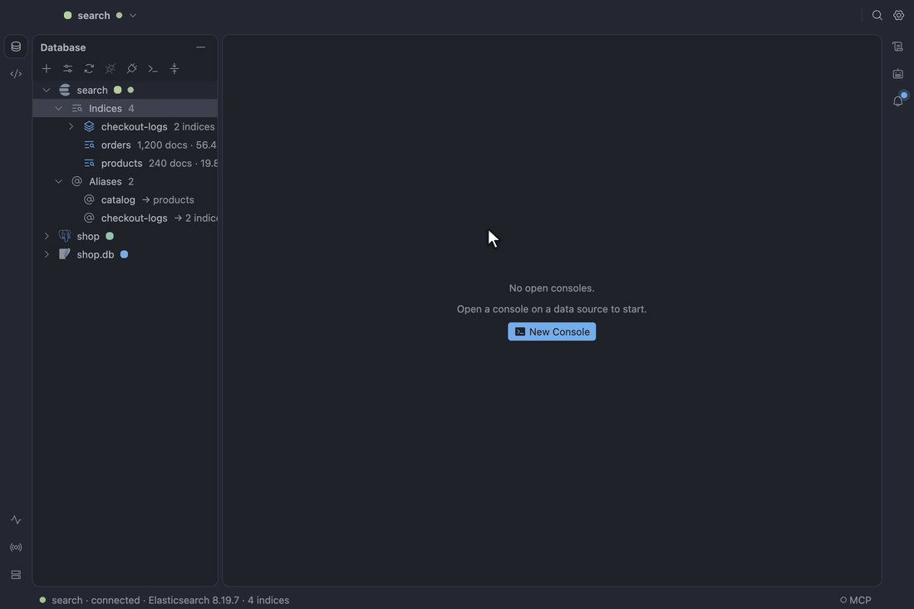

# Elasticsearch and OpenSearch

The Elasticsearch plugin speaks Elasticsearch 6.0 and later and OpenSearch 1.0 and later over their
REST API, with no driver of its own
([decision 173](../decisions/173-the-elasticsearch-plugin-speaks-rest-without-a-driver.md)). It
[downloads the first time you add an Elasticsearch or OpenSearch data
source](plugins.md#databases-in-the-box-and-on-demand). Indices list in the Database pane, an index
opens in a tab you search from, and the console takes Dev Tools requests.



## Connect

Give the **Host** and **Port** of one node (9200 by default). TableCraft talks to the node you name
and never discovers the others.

Pick the **Authentication**:

- **None**.
- **Username and password**: basic authentication.
- **API key**.
- **Bearer token**.

Passwords, API keys and tokens are kept in your system keychain like any other secret.

Pick the **TLS** mode:

- **Off (http)**: plain `http`.
- **Verify full**.
- **Verify CA**.
- **Require (no verification)**: encrypted, without checking the certificate.

The advanced fields take a CA file and a client certificate and key. A cluster behind a proxy that
serves it under a path, such as `/es`, takes that path in the advanced **Path prefix**.

On connect, TableCraft reads the cluster's version and adapts to it: mapping types on 6.x, the
shape of hit totals, the date histogram's interval and the SQL endpoint.

When `GET /` is refused or times out, as it can behind a gateway or proxy, TableCraft asks the node
it reached (`_nodes/_local/version`) and then `_cat/nodes`, taking the oldest version there. That
last answer names no distribution, so a version below 6 reads as OpenSearch.

### List only some indices

On a cluster shared by many teams, fill in the advanced **Index filter** with globs separated by
commas, such as `logs-*, products`. The tree then lists only the indices, aliases and data streams
whose names match. A console request or a tab opened by name still reaches any of them.

## Database tree

The tree has four folders:

- **Indices**, each with its document count and size, such as `2,431 docs · 1.2 MB`. The server
  counts them, so an index with `nested` fields counts each nested object too. A yellow or red
  index shows its health beside the name.
- **Data streams**, with their backing indices.
- **Aliases**, with the index they point at.
- **Hidden**, for system indices whose names start with `.`, folded away with their count.

Indices that roll over (`logs-checkout-000411`, `logs-checkout-000412`) or carry a date
(`audit-2026.11.20`, `logs-billing-2026-09-0001`) fold into one family row, newest first. Other
names fold on the part before the first `.` when two or more share it.

### Choose the indices the tree lists

1. On the data source or an index, choose **Manage Shown Indices…**.
2. Pick the indices, with the search box to find them.

Indices that roll over or carry a date are one row, such as `orders-*`. Picking it keeps the
indices it rolls over to later, and the alias that writes to it, which shows as `alias orders` on the
row; searching for the alias finds it. Any other index, alias or data stream is a row of its own,
and one created later stays hidden until you pick it.

The data source row then reads `3 of 40`. A console request or a tab opened by name still reaches
any index. To list every index again, choose **All indices**. Unlike the **Index filter**, which
the connection applies for anyone using it, this choice changes only what the tree shows.

### Filter the tree

Past 200 indices, a filter row sits at the top of the data source's indices. On a smaller cluster,
choose **Filter Indices…** in the command palette to show it.

Type part of a name, or `*` for any characters: `logs-*-2026`. Press Escape to clear the filter.
While the filter is set, only the matches stay, inside their families and folders, opened, with
`12 of 8,760` beside the box.

## Index tab

Opening an index, an alias or a data stream shows its **Documents**, **Mapping**, **Settings** and
**Analyze** views.

**Documents** is a result grid with one row per hit: `_id`, the index when the target spans several,
the score when the hits are not sorted, a column per field, and the whole `_source` as JSON. A
narrow mapping shows every field. A wide one, such as a log index with a hundred fields, starts with
the time, the level, the message and a few keyword fields. A field missing from a document reads
`<null>`.

### Search an index

1. In the query bar, pick **Lucene** or **DSL**.
2. Type the query. Lucene reads `category:coffee AND price:[* TO 20]`, and every term is required
   unless you write `OR`. DSL takes a Query DSL object: `{"term": {"sku": "p-1"}}`.
3. Pick a field to sort on, and its order.
4. Press Enter or click **Run**.

The hits fill the grid. An error from the cluster shows under the bar and keeps the rows of the last
search.

### Search a time range

When the target has an `@timestamp` date field, the bar offers a time range, _Last 15 minutes_ by
default, and sorts newest first. A histogram of the hits over the range sits above the grid. It
shows the hits per bar its height stands for and the time, in UTC, under every quarter. A bar the
range cuts short reads paler. The footer says how many shards the range let the cluster skip.

An [agent](agents.md) can open the view with a query, a sort and a range of its own. A range with
fixed ends shows in the menu as its dates, in UTC, until you pick another.

### Page through the hits

The first page is a plain search that leaves nothing open on the cluster. Scrolling the grid past it
opens a point in time (Elasticsearch 7.10+, OpenSearch 2.4+) and reads on from the last row shown,
so no row repeats or goes missing. Older servers use a scroll.

Either is released when the last page arrives, the result is released, the tab closes or the
connection ends. A cluster that refuses the release gets one warning, and the cursor expires after
5 minutes. On OpenSearch, paging past the first page sorts by `_id` as a tiebreaker.

The footer reads `1–100 of 2,431 hits · took 6 ms · 5 shards`. Past 10,000 the count reads
`≥ 10,000`. Shard failures show as a warning with the reason.

### Turn a search into a console request

Click **Request** to see the exact request the search sent. **Copy Search Request** copies it, and
**Open Search Request in Console** opens it in a console where you can change it.

### Read the mapping and settings

**Mapping** lists each field with its type, analyzer and multi-fields (`name.raw` under `name`), and
the mapping as JSON. On 6.x the header names the mapping type. **Settings** shows the index settings
as JSON.

### Analyze text

Open **Analyze**, pick a text field and type some text. Each step of the field's analyzer shows what it makes of the text: the tokenizer, then each token
filter in turn, with the tokens a step dropped struck out. When a query finds nothing because a
filter dropped a short word, this view shows why.

### Find a missing privilege

A view the signed-in user may not read, such as an index's settings, says so inside that view with
the cluster's reason, which names the missing privilege. The rest of the tab and the tree keep
working.

On a cluster with per-index permissions, a refused search shows under the bar, and a refused
histogram above the grid with the hits still shown. A refused `_analyze` shows in Analyze. Each
names the action, such as `indices:data/read/search`, and the privileges that grant it.

## Console

The console reads requests the way Kibana Dev Tools and OpenSearch Dashboards write them: a
`METHOD path` line, then a JSON body on the lines under it. `_bulk` and `_msearch` take one JSON
object per line. Lines starting with `#` or `//` are comments.

```text
GET products/_search
{
  "query": { "match": { "name": "flat white" } },
  "aggs": { "by_category": { "terms": { "field": "category" } } }
}

GET _cat/indices?v

SELECT category, COUNT(*) AS n FROM products GROUP BY category;
```

**Completion** offers the methods at the start of a line, then endpoints such as `_search` and
`_cat/indices` and the cluster's index names after the method, and Query DSL keys inside a body.

### Read the results

- A search shows its hits as a grid, and each aggregation as a grid of its own, one row per bucket,
  which you can chart.
- `_cat` requests show as a grid.
- A line starting with `SELECT`, `SHOW`, `DESCRIBE` or `EXPLAIN` goes to the cluster's SQL
  endpoint. On OpenSearch, a line starting with `source=` goes to PPL. Their answers show as a grid.
- Any other answer shows as JSON in Output.

### Run a request that changes data

Reads run at once. `DELETE <index>` deletes the index and every document in it, so TableCraft asks
you to type the data source's name first, as it does for a `DROP` in SQL. Deleting `_all`, a data
stream or a template asks too. A `_delete_by_query` that matches every document is marked as costly,
and a `_bulk` with `delete` actions as destructive.

A read-only data source refuses every request that would change something before it is sent.

### Cancel a request

Click **Cancel** to stop the running request by closing its connection. Elasticsearch 7.4 and later
and OpenSearch then stop the search on the cluster too.

## Limits

- Every search, count and histogram asks the cluster to stop after 30 seconds. A search that ran out
  shows the hits it found with a warning. A count that ran out fails, so it never shows a wrong
  number.
- A search in the index tab keeps at most 128 MB of rows. Past that the footer says it stopped, and
  a narrower query or time range reaches the rest.
- A field or `_source` longer than 32,768 characters keeps its start and `…`. `GET <index>/_doc/<id>`
  in the console reads the whole document.
- A page whose reply would pass 64 MB is asked for again ten times smaller.
- A family of hundreds of indices reads the mapping of its last four by name, the newest, and says
  so.
- In the console, a reply past 64 MB is dropped unread with advice to ask for less (`size`,
  `_source`, `filter_path`). Output shows the first 256 KB of a longer JSON answer, and a search grid
  keeps at most 128 MB of hits and says how many it showed.
- Documents cannot be edited in the grid, and there are no dialogs to create or delete indices and
  aliases: write the request in the console instead.
- Kibana Query Language (KQL), index lifecycle policies, snapshots, and security users and roles are
  not supported.
- Elasticsearch 5.x and older are not supported.
