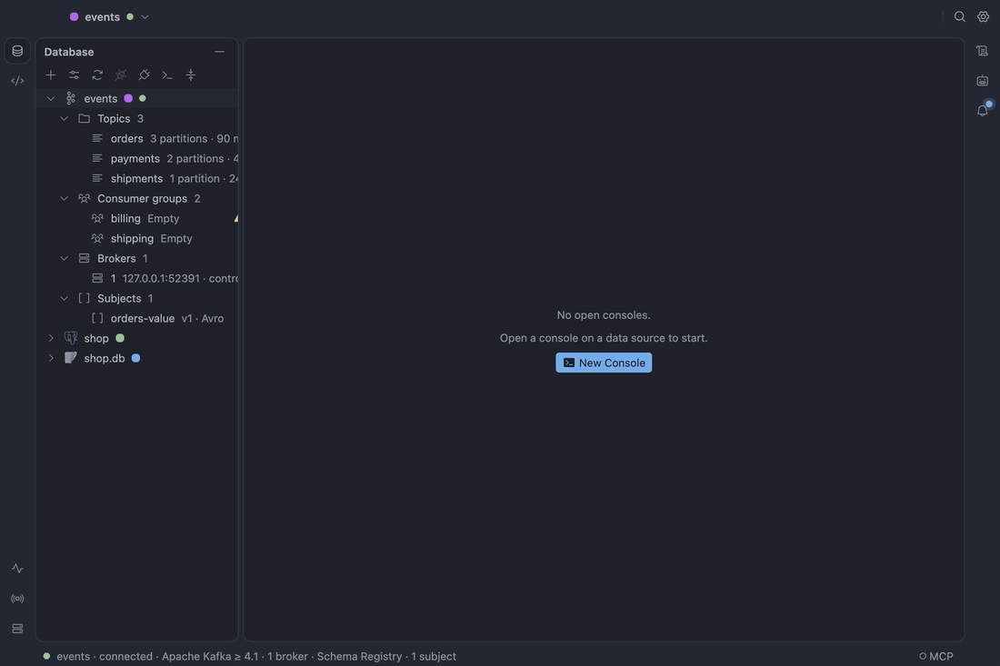

# Apache Kafka

The Kafka plugin [downloads the first time you add a Kafka data
source](plugins.md#databases-in-the-box-and-on-demand). Topics, consumer groups, brokers and
Schema Registry subjects list in the Database pane. A topic opens in a tab that reads its messages,
a group in a tab that shows its lag, and the console takes `kcat`-shaped commands. See
[decision 169](../decisions/169-stream-services-are-capabilities-with-their-own-tree.md) and
[decision 171](../decisions/171-the-kafka-plugin-has-its-own-schema-registry-client.md) for the
design.

## Connect

List the **Bootstrap servers** (`host:port`, comma separated) and pick the **Security** protocol:

- `PLAINTEXT`.
- `SSL`: TLS, with a client certificate for mutual TLS.
- `SASL_PLAINTEXT` or `SASL_SSL`, with SASL `PLAIN`, `SCRAM-SHA-256` or `SCRAM-SHA-512`.

A **Schema Registry URL**, with basic authentication if it asks for one, lets TableCraft decode and
encode Avro, Protobuf and JSON Schema messages.

On connect, TableCraft checks that the brokers answer the requests it needs, and names the missing
one when they do not.

### List only some topics

On a cluster shared by many teams, fill in the advanced **Name filter** with globs separated by
commas, such as `orders.*, payments.*`. The tree then lists only the topics, consumer groups and
subjects whose names match. A console command or a tab opened by name still reaches any of them.

## Database tree

The tree has four folders:

- **Topics**, with their full names, each with its partition count and an estimated message count,
  such as `12 partitions · ~3.4 M messages`. Topics fold on the part before the first `.` when two
  or more share it (and not every topic does). **Show Internal Topics** lists Kafka's own.
- **Consumer groups**, with their state and total lag. A lag above the data source's **Lag warning**
  shows a warning sign and the word _lagging_.
- **Brokers**, with the controller marked. Double-click a broker for its information.
- **Subjects** of the Schema Registry, with their latest version and type.

### Choose the topics the tree lists

1. On the data source or a topic, choose **Manage Shown Topics…**.
2. Pick the topics, with the search box to find them.

The data source row then reads `3 of 120`. Topics created later stay hidden until you pick them, and
a console command or a tab opened by name still reaches any topic. To list every topic again, choose
**All topics**.

## Topic tab

A topic tab reads partitions directly, so it never joins a group: it commits no offset, starts no
rebalance and leaves no group behind
([decision 170](../decisions/170-browsing-a-topic-never-joins-a-group.md)).

### Read messages

1. In **Messages**, pick where to start: the latest N (500 by default), the earliest offset, an
   offset, a time, or a group's committed offsets.
2. Keep all partitions, or type the ones you want: `0, 3, 7`.
3. Click **Read**.

Up to 50,000 rows fill the grid. **Read** turns into **Cancel** while it runs, and a cancelled read
keeps the rows of the previous one. Warnings, such as a value that did not decode, show as a count
beside a warning sign; hover it to read them.

Times you type are read in your local time zone, named beside the field with the UTC instant they
resolve to. The grid's timestamps are UTC.

### Filter messages

Type text or a `/regex/` in **Filter**. Only the messages whose key, value or headers contain or
match it stay. The footer counts what the read showed, such as `10 of 91 scanned`; hover the count
for how far the read went.

Under Latest N, a filter searches only the newest N of each partition. The footer then offers
**Search Earlier**, which reads the topic from its earliest offset with the same filter. A read that
stopped short offers **Scan Further**, which carries on where it stopped.

### Show one partition

A strip above the grid counts the rows read from each partition. Click a partition to show only its
rows, and click it again to show all. To read that partition alone, right-click it and choose
**Read Only Partition**.

### Pick a format

Pick the key and value format per topic: Auto, String, JSON, Avro, Protobuf, JSON Schema, Hex,
Base64 or a number. Auto reads the Schema Registry's framing and shows the schema each message used.
A value that does not decode shows as Hex with a warning, and the row stays.

### Inspect a message

Turn on the grid's **Value Panel** and select a message. The panel shows its value laid out, its
headers, and its partition, offset, time, size and schema ids. When the read started from a group,
the message at that group's committed offset says so.

- **Copy Message as JSON** copies all of it.
- **Open Message in Console** writes the `consume` command that reads it again.

### Read a large message

A message whose key, value or headers run past 1,024 characters shows its first 1,024 characters in
the grid, ending in `…`. The whole message waits in a temporary file on your disk. The message
details, Copy (of cells or rows, in any format), Copy Message as JSON, **Produce Again** and Export
read it from there, so they always give the whole message.

The files are plain text, readable only by you. They are deleted when the rows are released or the
tab closes, and any left by a crash at the next start.

To keep whole messages in memory instead, up to 128 MB a read, turn **Keep large messages on disk**
off in **Settings → Data Editor** (`data.spillMessages`)
([decision 172](../decisions/172-large-stream-messages-spill-to-a-temporary-file.md)).

### Check partitions, configs and consumers

- **Partitions** lists leaders, replicas, in-sync replicas (an under-replicated partition says so)
  and watermarks, with **Add Partitions…** and **Delete Records…**.
- **Configs** lists each setting with its source, with **Edit Topic Configs…**.
- **Consumers** lists the groups that commit on the topic, with their state and lag.

## Consumer group tab

The tab shows the group's state, its members and their assignments. Per partition, it shows the
committed offset, the end offset and the lag on one scale, with the partitions far behind the rest
in amber. It refreshes itself while you look at it and says when it last did.

To read a partition from the group's committed offset, click **Read from Here** on its lag row, or
double-click the row. The topic opens on that partition.

### Reset offsets

1. Click **Reset Offsets…**.
2. Pick where to move the group: the earliest or latest offset, an offset, a time, or a shift.
3. Pick one topic or all, and every partition or the ones you type.
4. Read the preview of every partition.
5. Click the button, which names the consequence: **Apply and Skip N**, **Apply and Re-read N**, or
   both.

The group moves. The dialog warns when messages are skipped, or when more than the lag warning would
be read again.

### Skip a poison message

Choose **Skip Record on Partition N…** on a lag row, or **Skip This Record for a Group…** on a
message. Either opens Reset Offsets as a shift of one past that message.

## Producing

1. Choose **Produce Message…**.
2. Type a key, a value and headers.
3. Pick a **Partition**, or leave it to Kafka.
4. Click **Send**.

The message is encoded in the topic's format. When the topic has a `<topic>-value` subject, its
latest version is picked and named, and the value is checked against it before anything is sent.
The dialog shows the partition and offset the message landed on, and stays open for the next one.

## Topic administration

- **Create Topic…** sets the partitions, the replication factor and settings picked from the common
  ones. It warns when the name would collide with another topic once `.` becomes `_` in Kafka's
  metrics.
- **Edit Topic Configs…** edits settings or resets them to the default, listing each change before
  **Apply**.
- **Add Partitions…**.
- **Delete Records…** deletes before an offset, before a time, or all records, previewed per
  partition first.
- **Delete Topic…**.

### Confirm a write

Every write dialog names the data source in its title, and on a production (red) data source says so
in a strip. In Reset Offsets, Delete Records and Produce Message, Enter only refreshes the preview:
the button that applies runs on a click. Deleting a topic, deleting records, and resetting a group on
a production data source ask you to type its name.

On a read-only data source, producing and every change to a topic or group are off, and their
buttons say why.

## Live tail

### Tail a topic

1. Choose **Tail Topic**. New messages arrive in the **Live Tail** tool window, read without a group.
2. To freeze the view, click **Pause**. The tail keeps running and counts what arrived.
3. To narrow the view, type text or a `/regex/` in **Filter**.
4. Select a message to see its key, headers and value.

The tail keeps the newest messages within a memory limit, marks where it had to drop some, and draws
the newest 1,000. To read from a message in a topic tab, choose **Open in Topic Tab at This Offset**
or double-click it.

### Save the tail

**Export…** writes the held messages to a JSON Lines file, and **Copy as JSON Lines** copies them.

A large message shows its first 1,024 characters. Selecting it reads the whole one from the tail's
temporary file, which keeps the newest 512 MB of them, so an older one may say only its first 1,024
characters are kept. Export and Copy write whole messages from that file. A message the file no
longer holds, or one past 64 MB of copied text, goes out as its first 1,024 characters, and Export
and Copy say how many did.

## Schema Registry

Double-click a subject for its tab: its versions, each version's schema and the compatibility level.

- **Check Compatibility…** checks a new schema.
- **Register New Version…** registers one.

## Console

The console takes `kcat`-shaped commands with completion: `topics`, `describe`, `consume`,
`produce`, `create-topic`, `delete-topic`, `alter-config`, `add-partitions`, `delete-records`,
`groups`, `group`, `lag`, `reset-offsets` (`--dry-run` previews), `delete-group`, `delete-offsets`,
`brokers`, `subjects`, `schema`, `register` and `compatibility`.

Commands that change the cluster are refused on a read-only data source, and deleting asks you to
confirm.

## Limits

- Kafka hands clients the addresses its brokers advertise, so the machine running TableCraft must
  reach those addresses. An SSH tunnel to the bootstrap server alone would not, and the form offers
  none.
- A read keeps up to 64 MB of large-message previews, and all temporary files together up to 2 GB,
  always leaving 1 GB of the disk free. Past either, the read stops with a warning, and **Scan
  Further** carries on.
- Kafka only lets an empty group move, so resetting the offsets of a group with members is refused,
  naming them.
