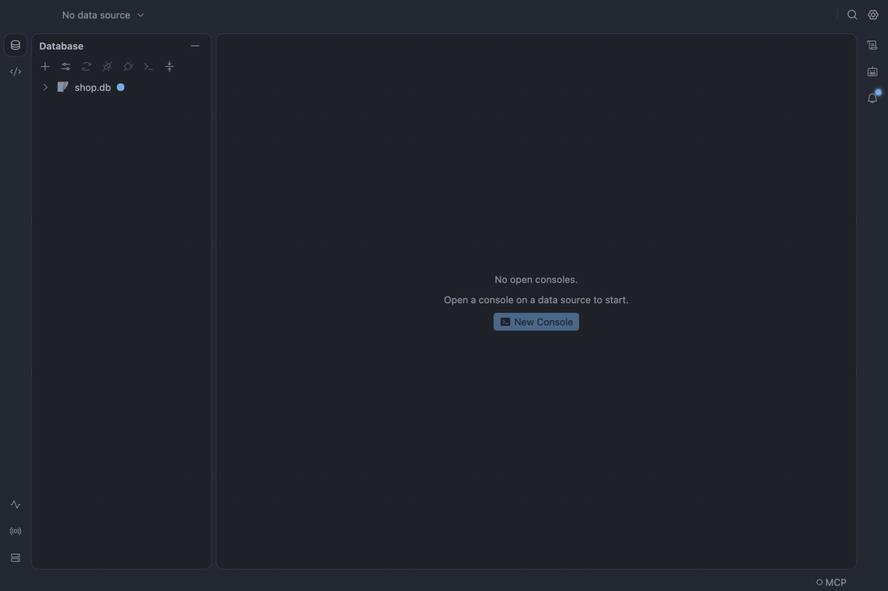

# Plugins

A plugin is a folder with a `table-craft-plugin.json` manifest and an ES module. The built-in
plugins ship inside the app, TableCraft offers others to
[download on demand](#databases-in-the-box-and-on-demand), and your own go in `plugins/<id>/` in
the [profile folder](data-and-privacy.md), where they load the same way. One that fails to load is
listed as unavailable with the reason. The app keeps running.

## Databases in the box and on demand

SQLite and MySQL (with MariaDB and TiDB) ship inside the app and work offline from the first
launch. The other databases are plugins TableCraft downloads from npm when you need them
([decision 108](../decisions/108-sqlite-and-mysql-ship-other-plugins-download.md),
[decision 156](../decisions/156-native-drivers-ship-one-package-per-platform.md)):

- PostgreSQL, about 190 KB, as
  [`@tablecraft-app/plugin-postgres`](https://www.npmjs.com/package/@tablecraft-app/plugin-postgres).
- Redis, about 290 KB, as
  [`@tablecraft-app/plugin-redis`](https://www.npmjs.com/package/@tablecraft-app/plugin-redis).
- Oracle, about 360 KB, as
  [`@tablecraft-app/plugin-oracle`](https://www.npmjs.com/package/@tablecraft-app/plugin-oracle).
- SQL Server (2017 and later, and Azure SQL), about 760 KB, as
  [`@tablecraft-app/plugin-mssql`](https://www.npmjs.com/package/@tablecraft-app/plugin-mssql).
- etcd (3.5 and later), about 400 KB, as
  [`@tablecraft-app/plugin-etcd`](https://www.npmjs.com/package/@tablecraft-app/plugin-etcd). See
  [etcd](etcd.md).
- DuckDB, about 29 MB because it carries DuckDB itself, as `@tablecraft-app/plugin-duckdb` followed
  by the system, such as
  [`@tablecraft-app/plugin-duckdb-darwin-arm64`](https://www.npmjs.com/package/@tablecraft-app/plugin-duckdb-darwin-arm64),
  for macOS, Windows and Linux on x64 and arm64. See [DuckDB](duckdb.md).
- Apache Kafka, about 1.2 MB, as
  [`@tablecraft-app/plugin-kafka`](https://www.npmjs.com/package/@tablecraft-app/plugin-kafka). See
  [Apache Kafka](kafka.md).
- Elasticsearch and OpenSearch, about 200 KB, as
  [`@tablecraft-app/plugin-elasticsearch`](https://www.npmjs.com/package/@tablecraft-app/plugin-elasticsearch).
  See [Elasticsearch and OpenSearch](elasticsearch.md).

### Download a plugin

**Data Sources +** lists PostgreSQL, Redis, Oracle, SQL Server, etcd, DuckDB, Apache Kafka and
Elasticsearch with **Download**. Choose one to see the download's progress, then the connection
form.

TableCraft installs the newest release its plugin API accepts, and refuses a download whose sha512
does not match the registry's. It keeps each version in `managed-plugins/` in the profile folder
([decision 110](../decisions/110-the-app-installs-plugins-from-the-registry.md)). To get beta
versions too, check **Get beta versions** in **Settings → Advanced**.

### Install a missing plugin

A saved data source whose plugin is missing shows greyed in the Database pane with **Install**.

After an update from a version that had PostgreSQL built in, TableCraft installs it in the
background on the first start, with no question.

### Plugins built for another plugin API

A downloaded plugin built for an older plugin API than this TableCraft cannot run, so it is treated
as missing. TableCraft downloads the build for this version as soon as it starts, even with
automatic checks off, and the data source shows **Updating…**. Connecting waits for it.

- If the download fails, the data source shows **Update failed** with **Retry**, and connecting says
  the plugin must be updated.
- A plugin you built or installed from a file is left alone, and listed as unavailable until you
  rebuild it.

A plugin built for a newer plugin API shows **Needs a newer TableCraft**, with **Check for
Updates**.

### Manage plugins

**Settings → Plugins** lists:

- the built-in plugins,
- the downloaded ones, with their version, **Update** and **Remove**. Remove is refused while a
  data source uses the plugin, and names it.
- your own, with **Remove**, which moves the plugin's folder to the Trash. A copy of your own that a
  downloaded plugin of the same id shadows can always be removed.

With **Check for updates automatically** on, downloaded plugins are checked every 2 hours, and a
newer compatible version is used from the next connection.

### Install from a file

Offline or behind a firewall, use the plugin `.tgz` files every release attaches.

1. Open **Settings → Plugins**.
2. Choose **Install from File…** and pick the file.
3. Confirm the install.

TableCraft asks before installing any file. It refuses a DuckDB file built for another system, and
names the one to pick.

### Use a corporate npm mirror

Behind a corporate npm mirror, set its address in **Settings → Plugins** (`plugins.registryUrl`).

## Private registries

A plugin your company publishes to its own npm registry, such as GitLab's package registry,
installs from there by its scope, while official plugins keep coming from npm. How routing, tokens
and checksums work is in [decision 158](../decisions/158-private-plugin-registries.md).

### Add a registry

1. In **Settings → Plugins → Registries**, choose **+ Add registry**.
2. Fill in a name and the registry's npm address, such as
   `https://gitlab.example.com/api/v4/packages/npm`.
3. Fill in its scopes, such as `@acme`, and a token. For GitLab, use a personal or group access
   token with `read_api`.
4. Click **Test connection** to check the address and the token.
5. Click **Save**.

The registry shows as a card. A scope belongs to one registry, and `@tablecraft-app` always comes
from npm.

The token is kept encrypted by the system keychain, never in `settings.json`, and never shown again.
TableCraft sends it only to the registry's own host: a download that leaves it goes without the
token.

### Install a plugin from a registry

1. Under **Available**, type the package name, such as `@acme/tablecraft-plugin-example`.
2. Choose **Install…**.
3. Read what the plugin adds, and confirm.

TableCraft picks the newest version this TableCraft can run, and asks once before installing a
package from a private registry. Updates come from the same registry without asking again.

GitLab publishes only a sha-1 checksum, which TableCraft checks for a private registry. A package
from npm still needs its sha512.

### Replace a refused token

A refused token turns the registry's card red. Paste a new one there.

### Remove a registry

Removing a registry forgets its token and keeps its plugins installed, but they stop updating.

To write a plugin of your own, see [Writing plugins](writing-plugins.md).
